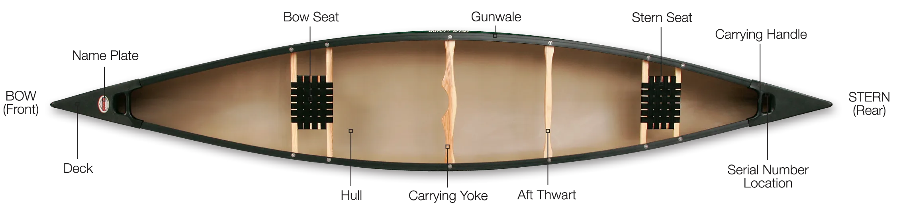

# CLAUDE.md

Guidance for Claude Code (claude.ai/code) when working in this repository.

## What this is

Yurii Rashkovskii's personal site, **yrashk.com**: a tiling "OS" desktop (the app shell, with the
Atlas, terminal, Lab query console) plus a reader for essays. It is a static site generated by a
small Node script and published to GitHub Pages from the `gh-pages` branch.

Content and persona rules live in `site/CONTENT.md`; the data contract (Atlas, RDF, Lab console)
in `site/DATA.md`. Read them before touching copy or data.

## Layout

```
site/
  app/            the OS shell: index.html (served at /), sparql.js, …  (sparql-harness.html is dev-only)
  data/           github.json/.js, contrib.js (generated), atlas.json/.js (curated), atlas.ttl (generated),
                  rdf/ (WAT RDF engine), portraits        → served at /data/
  content/posts/  essays: YYYY-MM-DD-slug.md (or .html), frontmatter below
  content/notes/  short notes: YYYY-MM-DD-slug.md → /data/notes.js (see its README)
  templates/      article.html (the reader), 404.html
  static/         copied verbatim to the site root (favicon, CNAME, /blog/posts/*.png images)
  copy-guard.txt  phrases that must never appear in the built site
  CONTENT.md, DATA.md
scripts/
  build.mjs       the generator (markdown-it + shiki)         → dist/
  check.mjs       link checker + required URLs + copy guard over dist/
  serve.mjs       tiny static server for dist/ (Pages semantics: dirs → index.html, misses → 404)
  github-data.mjs GitHub activity → site/data/github.*, contrib.js, github-detail.json
  atlas-rdf.mjs   atlas.json + github.json → site/data/atlas.ttl (and atlas.js)
  strava-rdf.mjs  a Strava bulk export → site/data/strava.js, strava-tracks.json, strava.ttl (privacy-trimmed)
dist/             build output (gitignored)
prototypes/       the four earlier design directions, local reference only (gitignored)
```

## Commands

```bash
npm ci                 # once (Node 20+)
npm run build          # node scripts/build.mjs → dist/   (deterministic; ~0.3 s)
npm run check          # must pass before anything ships; CI runs it
npm run serve          # http://localhost:8080/ (node scripts/serve.mjs [port] [dir])
npm run data           # refresh GitHub data + regenerate atlas.ttl (needs GITHUB_TOKEN or `gh auth`)
npm run strava:update  # import the newest ~/Downloads/export_*.zip from Strava, build, check (site/DATA.md)
```

`build` writes: `/index.html` (the shell, with `../data/` → `/data/`, `index.html` → `/`, and
`/data/posts.js` + `/data/notes.js` script tags injected after the data scripts), every post at
its permalink, `/data/*`, `/feed.xml`, `/feed_rss_created.xml`, `/feed_rss_updated.xml` (listed
posts, full content), `/sitemap.xml`, `/robots.txt`, `/CNAME`, `/404.html`, and redirect stubs for
retired MkDocs pages (`/blog/`, `/blog/category/*`, `/opensource/`, `/startups/`, `/call/`,
`/awesome/`, `/postgres/` → the desktop). It never writes under `/strata/` (another repository
serves that path).

## Rules that must not break

- **Old permalinks never change.** Every post's `permalink` is its URL forever; `check` verifies
  all eleven original `/blog/YYYY/MM/DD/slug/` URLs, the retired pages, and both legacy feed paths.
  Never rename a permalink; add a redirect stub in `build.mjs`'s `RETIRED` table if a page goes away.
- **Images referenced by old posts stay at `/blog/posts/<file>`** (`site/static/blog/posts/`).
- **Copy guard.** `site/copy-guard.txt` lists banned phrases (plain, case-insensitive, or `/regex/`,
  with `#` comments). `check` scans the visible text of every page (text nodes, title, alt,
  aria-label, meta, UI strings in scripts; not code blocks or comments) and `data/atlas.json`,
  `atlas.ttl`, `posts.js`, `notes.js`. `github.json`/`github.js` are raw API data and exempt. When a
  copy decision is made, add it there so it sticks.
- The shell (`site/app/index.html`) and the data files are owned by their own workflows; the build
  copies them and rewrites paths only. Do not fork copies of them.

## Posts

`site/content/posts/YYYY-MM-DD-slug.md`:

```yaml
---
title: What happens if you put HTTP server inside Postgres?
date: 2023-02-16
permalink: /blog/2023/02/16/what-happens-if-you-put-http-server-inside-postgres/
tags:
  - Postgres
  - Omnigres
excerpt: "One or two sentences; used in lists, feeds and meta description."
# optional:
# listed: false        # posts are LISTED by default; set false to keep a post reachable but off lists/feeds/sitemap
# updated: 2024-01-01  # drives feed_rss_updated.xml
# standfirst: "A deck shown under the title (default: the excerpt, unless it repeats the opening)."
# series: Omnigres     # rail label (default: the Atlas body the post orbits)
# original: https://medium.com/@yrashk/…   # where an imported post first ran; shown as "first published on <venue>"
# originalVenue: Medium                     # (default: the original's hostname). The canonical URL stays on yrashk.com.
---
```

The Atlas locator in the rail comes from `site/data/atlas.json`: a `kind: writing` body whose
`url` equals the permalink supplies the sector, position (`f`, `year`) and `related` body. Posts
without a body still render (default sector "writing").

`/data/posts.js` carries `{id, title, date, url, tags, excerpt, listed, featured, related}` for
every post, newest first; the Writing window decides what to feature from it.

### Markdown dialect

CommonMark via markdown-it, plus: footnotes (`[^id]`), `==mark==`, `~~strike~~`, attributes
(`{ #id .class }`), heading anchors with Python-Markdown-style slugs (old `#anchors` keep working),
and these containers:

```markdown
::: warning Outdated API          ← admonition: note info abstract tip hint success question
Body, any Markdown.                  help warning caution danger failure bug example quote
:::

::: details example MOTD service code   ← collapsible (<details>)
...
:::

:::: tabs                          ← tabs (stacked sections without JS)
::: tab Default image
...
:::
::: tab Slim image
...
:::
::::

::: figure Canoe, picture by oldtowncanoe.com

:::
```

Code fences: ```` ```lang {4-8} title="file.sql" ```` — highlighted at build time by shiki with
the reader's own palette (CSS variables; no client-side highlighter). `postgresql`/`psql` map to
SQL, `shell` to shellscript; unknown languages render as text with a build warning.

### Raw HTML escape hatch

`html: true` is on. Block-level HTML passes through intact and gets the reader's `.prose` styling;
Markdown works inside an HTML block when separated by blank lines:

```markdown
<details>
<summary>Transcript</summary>

Markdown *inside* the element, lists, `code`, footnotes[^1].

</details>

<div id="demo"></div>
<script type="module">document.getElementById('demo').textContent = 'interactive';</script>
```

For a fully custom piece, write `YYYY-MM-DD-slug.html`: the same frontmatter followed by an HTML
body. It is placed in the reader as-is (TOC from `<h2 id>`/`<h3 id>`; no highlighting).

## Notes

`site/content/notes/YYYY-MM-DD-slug.md` with `title`, `date`, `tags` frontmatter and a short
body; the build emits `/data/notes.js` (`window.NOTES`). With no notes the desktop shows its
built-in samples. See `site/content/notes/README.md`.

## Data

- `npm run data` = `github-data.mjs site/data` (GitHub GraphQL/REST; excludes repos in its
  `EXCLUDE` set) then `atlas-rdf.mjs site/data` (Turtle per `site/DATA.md`). Both are
  dependency-free and committed outputs are kept so a build works offline.
- `site/data/atlas.json` is hand-curated; keep `atlas.js` in sync (`atlas-rdf.mjs` regenerates it).

## CI

`.github/workflows/pages.yml`: on push to `master`, daily (04:17 UTC) and on demand:
checkout → setup-node (LTS, npm cache) → `npm ci` → `github-data.mjs` (falls back to the committed
files if the API fails) → `atlas-rdf.mjs` → `npm run build` → `npm run check` → publish `dist/`
to `gh-pages` (peaceiris/actions-gh-pages, `cname: yrashk.com`). Only `GITHUB_TOKEN` is used.

## Git conventions

Commit messages follow the Problem/Solution (C4) style the history already uses:
`Problem: …` as the subject, `Solution: …` in the body.
