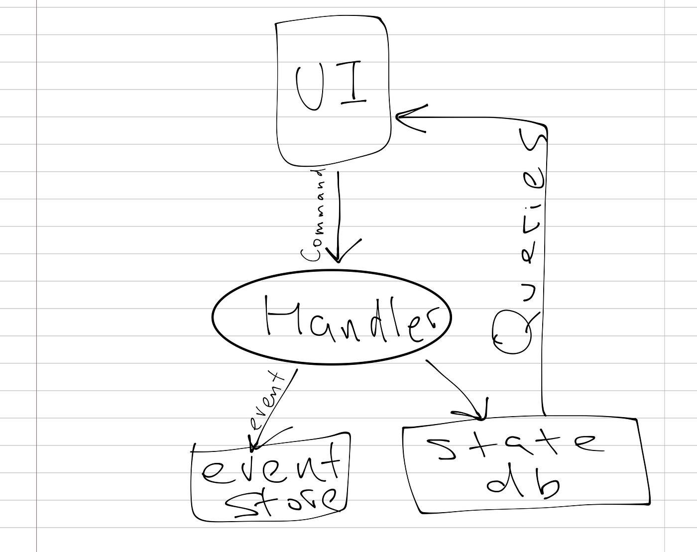

If you read Fowler’s [article on event sourcing](http://martinfowler.com/eaaDev/EventSourcing.html) or learned about it through many other sources, there’s one particular mental picture of this approach that you might have affixed to your brain.

::: figure Classic event sourcing approach

:::

Basically, user’s UI (or another external system) generates commands, we process them by logging them to the event store and updating the *“state of the world”* database, which, in turn, is queried against by the end user application.

This approach is remarkably simple and beautiful (we are able to replay the events, we’re able to query the data and we can still leverage the battlefield proven database of our choice), but I noticed that what I really was looking for in event sourcing is the ability to *avoid predicting the future* and this model wasn’t particularly solving it because I had to write down the updated state of the world to the database.

Let me elaborate. The idea of being able to collect the intent of the action and all accompanying data naturally brings us to the idea of being able to look in the past and extract information that was not particularly useful back when the events were logged (new insights, new functionality, whatever the reason is). So what does that mean? Should I migrate my database to account for this new information and load the missing data? Should I replay my events and repopulate the database?

None of that sounded particularly easy to me.

Having developed a multitude of projects during my career, I learned the obvious idea that everything changes the hard way. There is simply no way to know what your application and its domain models will look like months ahead of time. Unless it’s your third rewrite, and even that is iffy.

What if I can delay the prediction of the future until we are in that future? By logging events to the event store, I can always rebuild the state just the way it is necessary at that point in time. Except that, as I’ve pointed out earlier, that’s a costly solution if you have to run through every event you’ve logged to rebuild the state.

But what if I can simply query the events when I need to show data to the user? Let’s say we have a user and users typically have an email address associated with them. Let’s assume we had a *UserCreated* event and a number of *EmailChanged* events. What if, instead of building a state database with all the users, whenever the user information is requested, we only had to search for *UserCreated(id: &lt;id>)* and the last *EmailChanged(userId: &lt;id>)*?

Huh. So this way, we can simply have an on-demand (lazy) retrieval of this piece of user’s information without incurring the cost of maintaining the entire state database.

If the algorithm for figuring out user’s email ever changes, all I have to do is to change this method. Most importantly, until I write *User#email()*, I don’t have to know that this is how I will shape the data. I just need to record all the data in my events without a loss.

What is even more interesting, this approach has led me to a logical next step: *there is no single version of the “state of the world”*. Just like we, humans, experience the world and reality in different ways, programs can see the reality through different prisms and there are little to no reasons why they shouldn’t be able to.

Does this approach have tradeoffs? It sure does. For one, if your on-demand event search/computation is expensive, that’s a problem. However, when such hotspots are discovered, they can be optimized by pre-processing and caching (although it is best to avoid expensive searches altogether, but that’s not always possible).

Does this mean we shouldn’t have event handlers that are executed at the time of event logging? Don’t think so, it’s still a very valid use case. Just doesn’t have to be done for every event.

Here’s another interesting consequence of this approach. With growing adoption of GraphQL, this means that our application will only query data that’s explicitly requested by the frontend application. Of course, this is not going to help the majority of REST-based applications, but can serve as a great extra incentive…

> This is the approach [Eventsourcing for Java](http://eventsourcing.com/) implements, along with its extension called [Domain Protocol](https://es4j.eventsourcing.com/docs/master/core_concepts/domain_protocol.html). It also has a [GraphQL adaptor](https://github.com/eventsourcing/es4j-graphql). ES4J is open source and is licensed under the terms of Mozilla Public License 2.0. Check it out!
