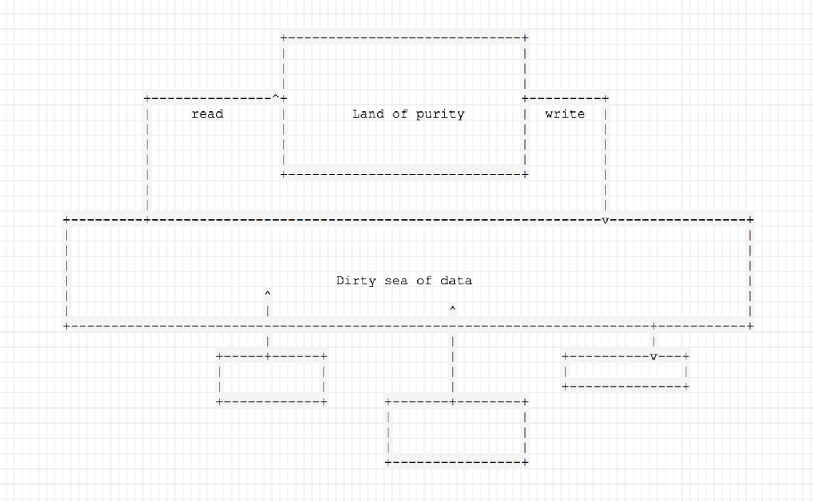

Earlier this year, on a rainy night in Bangkok, I was attending a regular Hack Night event, and I just had to jump into somebody’s else conversation without an invitation.

The guy I almost interrupted was describing the beauty and benefits of functional programming and, in particular, immutability. In fact, he was even pitching Elixir and if you know me, you know I’ve been engaged in the project for some time, so it was extra rewarding to listen to that.

Except for one thing.

I switched to the Java ecosystem as my primary stack some time ago, for a number of reasons. So listening in, I felt a mix of loss and guilt for abandoning such a beautiful functional ship for the industrial trenches and all their impurities. That didn’t feel good at all.

However, man is not a rational animal, he is a rationalizing one (*thank you, Mr. Heinlein*), so I was desperately seeking for a justification for not being in that camp anymore, even though I do understand the values and benefits of functional programming.

Almost nobody in the functional camp wants to hear the good old reasons of tooling, ecosystem maturity, community size, leadership, performance, etc. — these simply have been mulled over way too many times. While I believe that many of these reasons are quite valid and are in fact my reasons for changing ships, I felt like there’s also something more important about it.

Something not immediately obvious.

I’ve been mildly obsessed with data modelling and databases for at least a decade now. Programs without data and without data persistence aren’t very practical, of course, but accepting that there is only one way to do that wasn’t very exciting, so I tried to learn more.

Once, I tried to marry the concepts of a frame database with a language-integrated database (*hello, MUMPS!*). Another time, I took Riak Core and ignored the CRDT work, opting for a bastardized interpretation of event sourcing and [built a prototype for a client in gaming](https://www.youtube.com/watch?v=ujaoprIKY9M).

For the past year or so, I’ve been on my follow-up quest to figure out the innards and hidden secrets of event sourcing. I’ve built a few private prototypes and then incorporated some of my findings into the [Eventsourcing project](https://eventsourcing.com).

Arguably, one of my most important discoveries has been that the phrase that begins with *“event…”* doesn’t have to end with “*handlers”*. That seems to be a common pattern in programming circles. If there’s an event, there must be a handler — a conflation with a concept of a message. Feels almost like a knee jerk reaction.

Instead, seeing an event as a *categorization*, simply a piece of data that represents something we considered to have happened, opens up some interesting opportunities. Suddenly, we don’t have to handle events when they “arrive” and we can simply store them.

We can index them, and query relevant ones on demand, when we need them, and construct domain model objects as we please. Since we never modify the events (after all, they have happened already!), we can see our data models as pure functions on events.

This is true even in the classic event sourcing model where you do handle the events to apply changes to the read side, but having that gap that “event handling” introduces, these functions might provide a different level of data consistency.

But what is even more interesting, is that, generally speaking, writing to such a database is similarly almost as functional. A command that generates events is a function on input data that returns journal entries and index records to be amended to the database.

When somebody is trying to write to such a database, they are no longer fighting for a shared resource, they can all write and the read side can figure out what to make of it.

So it hit me. Practical functional programming, in many instances, is far from delivering on its potential because while it works really well within code, the moment we persist data, all of that ends. In most applications, data on the disk is mutable, and the mutations are mostly not lossless. For practical reasons, the data that was updated is data gone.

So while functional approach make our lives better between the moments we hit the disk, its effect is significantly reduced by those reads and writes especially writes!)

If we consider the data layer as something that connects our business logic together (however *inside-out* this sounds*)*, then we have these pieces of pure, clean code floating in a sea of dirty mutable data.

Finally, I had a justification that I actually understood and believed in.

Often times, when we build systems, regardless of the underlying programming language, what we build is not quite functional *as a whole* because of the way we manage the data. So then, does it matter that some of the components aren’t pure?

Well, yes, it does as it would have been better to have those components done right — we’d save so much time fighting the bugs! However, combined into a system, they will still suffer from the trade-offs of the mutable, non-functional model.

So when I did jump into the conversation, I brought up exactly this issue — our systems are largely not functional.

But they can be.
