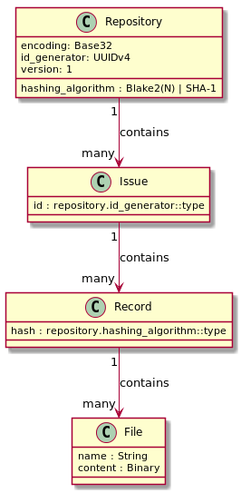
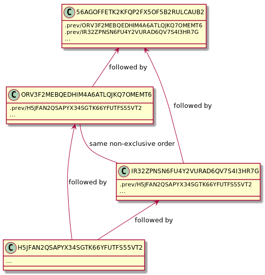

I remember that about 20 years ago, when I was just a bit more naive and a lot more confident in my opinions, I thought that code is the ultimate source of truth. Documentation was secondary to me. I was living and breathing code to that degree when it comes up in your dreams and you start questioning what happens to code when its creator dies.

And in a very narrow sense, code is the ultimate source of truth. It is what will be executed, period. But hear me out — the more I read code (mine or somebody else’s) the more scared I get at how much of a guessing game reading code is. There’s something lost there — original authors’ train of thought, their reasoning, heck, even their mental model.

With that in mind, I can’t help but ask myself a question: if we don’t quite understand code, is it really a source of truth? What truth is it a source of? I’ve lost a lot of productive hours pondering about these and related questions.

Almost two years ago, I had a privilege to learn more about ideas Pieter Hintjens was promoting, and even had a few telegraphic conversations with him. I watched perhaps all of his videos I could find on YouTube, read a bunch of his articles. He wanted to be remembered as a writer. He was putting a significant effort into capturing his experiences, thoughts and ideas. Why is this important to me?

I find this critical because this is about focusing on conveying knowledge as opposed to simply sharing the result of your work (such as working code, for example).

One of the simple ideas that caught my attention was preparing commit messages as Problem/Solution statements. I’ve [written](/blog/2017/09/04/solving-problems-one-commit-at-a-time/) about this before, about how this allows to capture the actual reason a particular patch was written — not what is done, but why. I’ve learned about the rule of five “W”s (Who/What/Where/When/Why) and how important these are for problem analysis and, ultimately, solution discovery.

I’ve started writing all of my commit messages this way, even for the simplest problems, even in personal repositories. I want to be able to go back and tell why things happened the way they did. I’ve been promoting this approach to others around me and I am happy to report that some have adopted it as well!

Back in the days, I believed that a choice of an issue tracking system isn’t very important. Once an issue is closed, it’s gone for good. So we can migrate to a new system by creating new issues on the new system and closing the remaining issues on the old one. I viewed such systems as… more of a TODO list. Once checked off, I have one less thing to worry about.

But after I’ve adopted the Problem/Solution statements approach, I discovered that I am now more likely to write detailed reports. More likely to record some thoughts in the issues about why things were done the way they were. Perhaps this is because I started viewing commit message as less of an annoying, auxiliary bit (“Fixed erroneous behavior", anyone?) but rather something worth leaving to posterity.

Still, a couple of issues have bothered me.

Firstly, most of these systems, lacked precision. For example, without an extra effort, it was hard to tell whether a certain issue has been resolved on a branch or, say, on master as well? Which code exactly has resolved it?

Secondly, they were victims of their author’s domain model and workflows they were familiar with. Sure, certain degree of customization was possible, but we still had to deal with what’s written down as a ticket with its dictionary of properties.

And lastly, it amused and saddened me that we’re often using centralized issue trackers, even when our SCMs aren’t. I wasn’t the only one concerned about this, but most of projects in the space got eventually abandoned and never gain significant adoption. The rest were ultimately storing this information on theirs or somebody else’s servers. So if anything was to go wrong, this stuff will *poof!* go away.

Being infected with the “event sourcing bug” it was clear to me that the only reasonable way to record issues and what happens to them is by recording every single event and using them as a source of truth. Instead of dealing with issue properties and its relationships with other entities (attachments, comments, etc.), we can record a set of events that happened to those issues and derive whatever projection we’re interested in based on that.

::: figure High-level overview

:::

So, what if issue was a file and events were written down in it? It’d work nicely… except for actual collaborative efforts. Merge conflicts are nobody’s friends so this won’t fly. I had to think further. How do we avoid merge conflicts?

Well, duh, what if we never write to the same file? What if every record to an issue was its own file, or, perhaps, even a collection of files (because why not, file is just another abstraction!). This way, whenever we merge, we’re never in conflict with anybody else on the project.

::: figure Record ordering example

:::

This is how [SIT](https://github.com/sit-it/sit) was born. I just couldn’t resist sitting down for a day and outlining the concept and writing some draft code. So, a few days ago, I did just that.

It is both a right of passage and something that is often frowned upon: developing your own issue tracker. Countless projects were started. Many got abandoned, few survived. Some grew into well-oiled business machines. Over the years, I was leaning towards the “frowning upon” camp.

So what’s SIT? It’s basically a simple issue tracker that works offline, uses plain text files that can be stored in any SCM (and it doesn’t even require any one to be present!), it’s loosely based on ideas stemming from event sourcing and (of course) it’s merge-friendly. It doesn’t yet have a great (or any) user interface, but that’s simply a matter of time.

Do I think it’ll survive? I am both skeptic and excited about it. I’ve seen many good projects get abandoned, my own as well. But I never stop trying when it comes to things I love doing, so I am putting an effort in it and let’s see what we’ll come out of it.

> SIT is ultimately about preserving decision making, notes and ideas over the lifetime of a project and maybe even longer.

Go check it out and try opening an issue [using an automated merge bot](https://github.com/sit-it/sit#send-it-to-upstream)!
